# Practica_3_II
**Asignatura:** Interfaces Inteligentes  
**Universidad:** Universidad de La Laguna (ULL)  
**Autor:** Darío ([@Dario-ULL](https://github.com/Dario-ULL))

---

## Estructura del Repositorio
- **Scripts/**: Contiene los scripts en C# desarrollados para los ejercicios prácticos de control físico e interacciones.
- **Gif/**: Contiene las capturas y animaciones GIF que demuestran el comportamiento de cada situación física y ejercicio.

---

## Configuración Inicial de la Escena
Para el análisis de las situaciones de físicas se prepara una escena base con tres objetos principales:
- **Plano (Plane):** Posición por defecto en el origen (0, 0, 0).
- **Cubo (Cube):** Ubicado en la cota de altura Y = 0.5 con escala unitaria, apoyado sobre el plano.
- **Esfera (Sphere):** Ubicada suspendida en el aire con Transform en Position (0.3, 1.87, 0).
- **Cámara principal (Main Camera):** En posición por defecto enfocando la escena de interacción.

---

## Bloque 1: Matriz de Situaciones Físicas 3D

### Situación 1
El plano y la esfera actúan como objetos no físicos (poseen únicamente componente Collider), mientras que el cubo es un objeto físico dinámico con Rigidbody. Al iniciar la simulación, la esfera permanece suspendida estática en el aire ya que PhysX no computa gravedad sobre ella, mientras el cubo descansa apoyado sólidamente sobre el plano.

  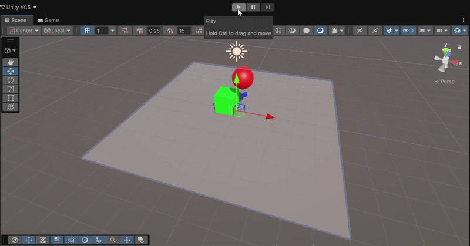

---

### Situación 2
El plano carece de Rigidbody (estático), mientras que tanto el cubo como la esfera cuentan con Rigidbody dinámico. Al ejecutarse la simulación, la esfera cae por efecto de la gravedad sobre el plano o contra el cubo, produciéndose una colisión elástica completa con transferencia de momento lineal entre ambos cuerpos.

  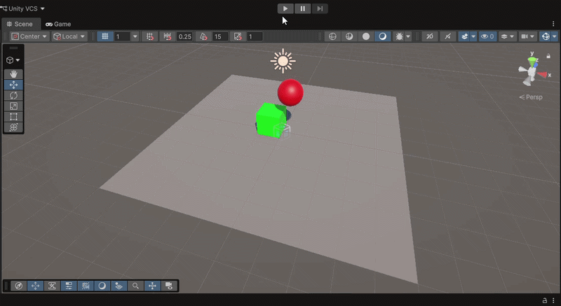

---

### Situación 3
El plano es estático (sin Rigidbody), el cubo es físico dinámico y la esfera incorpora un Rigidbody en modo cinemático (Is Kinematic = true). La esfera flota en el aire sin verse afectada por la gravedad ni por fuerzas externas, comportándose como un obstáculo de inercia infinita frente al cubo.

  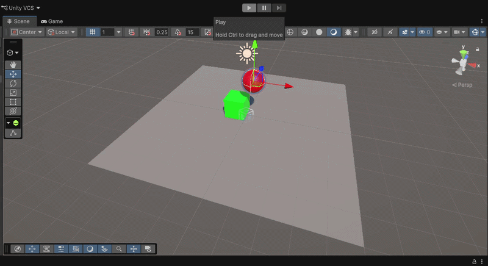

---

### Situación 4
Todos los elementos en la escena (plano, cubo y esfera) cuentan con componente Rigidbody dinámico. Al no estar congeladas sus posiciones ni marcado el plano como cinemático, la gravedad actúa sobre todo el conjunto provocando que el plano caiga indefinidamente al vacío arrastrando consigo a los demás cuerpos.

  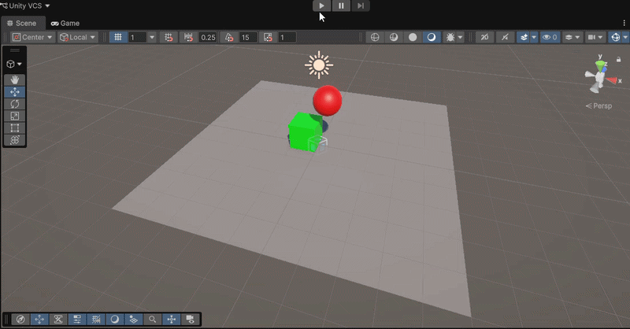

---

### Situación 5
El plano se configura como objeto físico cinemático (Is Kinematic = true, con Mesh Collider convexo), manteniéndose fijo como superficie de apoyo. El cubo posee masa unitaria ($m = 1$) y la esfera posee 10 veces más masa ($m = 10$). En la colisión, la esfera desplaza y aparta con facilidad al cubo debido a la asimetría en la conservación de momento ($p = m \cdot v$).

  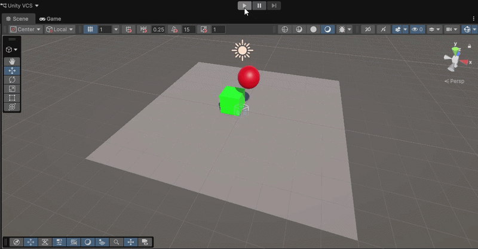

---

### Situación 6
El plano continúa como cinemático y la esfera se configura con 100 veces más masa que el cubo ($m = 100$ frente a $m = 1$). Al colisionar en la caída, el cubo sale repelido con gran violencia y aceleración, mientras que la trayectoria descendente de la esfera prácticamente no sufre alteración.

  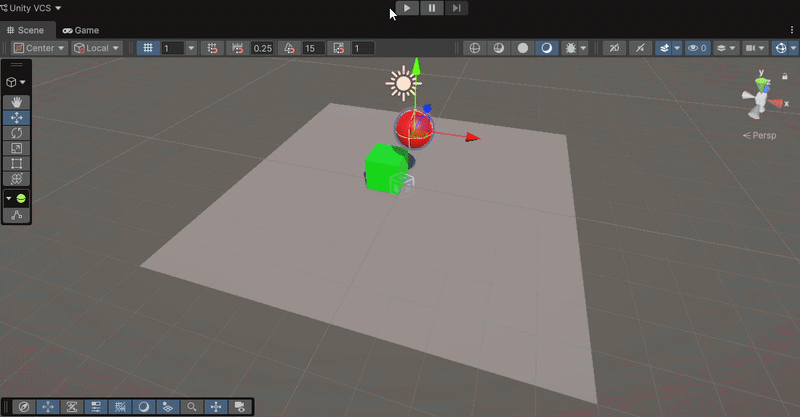

---

### Situación 7
Todos los objetos poseen Rigidbody, con el plano en modo cinemático y la esfera incorporando un Physics Material con altos valores de fricción estática y dinámica. El rozamiento en el punto de contacto impide el derrape plano y convierte la energía cinética de traslación en un torque continuo de rodadura (*rolling*).

  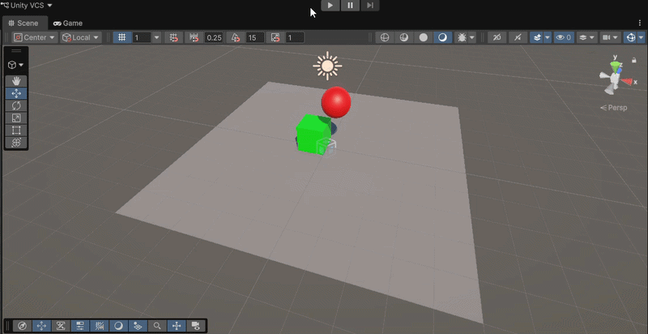

---

### Situación 8
El plano es cinemático, el cubo es físico y la esfera posee Rigidbody cinemático junto a la propiedad Is Trigger = true en su Sphere Collider. La esfera actúa como un sensor intangible en el espacio: se mantiene inmóvil en el aire y el cubo la atraviesa por completo sin que se produzca respuesta de colisión sólida.

  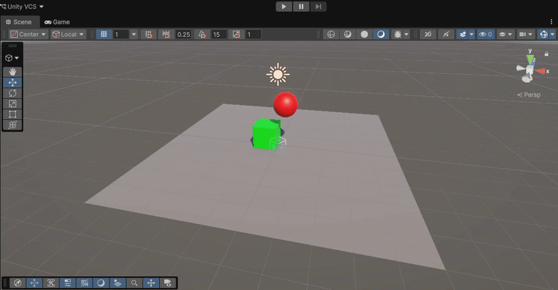

---

### Situación 9
El plano es cinemático, el cubo es dinámico y la esfera cuenta con Rigidbody dinámico (Use Gravity = true) pero con Is Trigger = true en su Collider. La esfera cae acelerada por la gravedad pero, al carecer de colisión sólida, atraviesa tanto el cubo como el plano, perdiéndose en el vacío.

  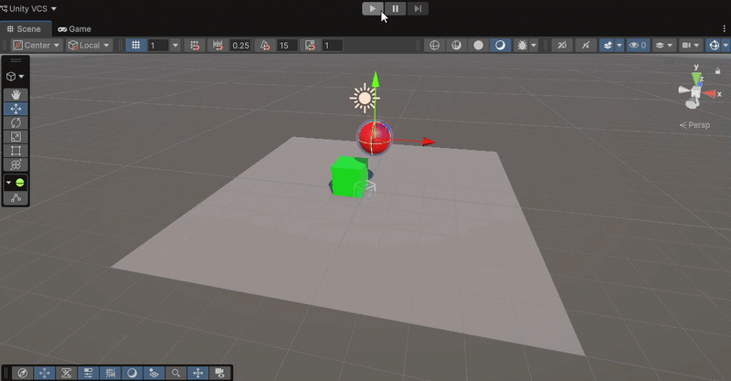

---

## Bloque 2: Ejercicios de Físicas 3D con Scripts

### Ejercicio 1
Control de desplazamiento de un personaje mediante las teclas WASD y los cursores utilizando su componente Rigidbody. Para garantizar un control total y evitar derrapes o balanceos indeseados, se congelan las rotaciones en los ejes $X$, $Y$ y $Z$ (Constraints: Freeze Rotation), capturando los ejes en Update y aplicando la velocidad horizontal directamente en FixedUpdate preservando la velocidad vertical natural generada por la gravedad.

  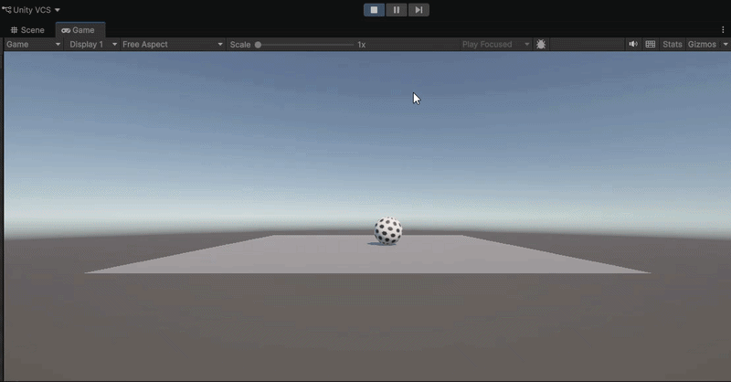

---

### Ejercicio 2
Instanciación de múltiples cuerpos dinámicos con Rigidbody sobre la escena. Al producirse un choque físico detectado mediante el evento OnCollisionEnter, se discrimina el suelo mediante tags para ignorar el plano y se muestra por la consola de Unity el nombre del objeto impactado, alterando aleatoriamente su color mediante una nueva instancia en su componente Renderer.

  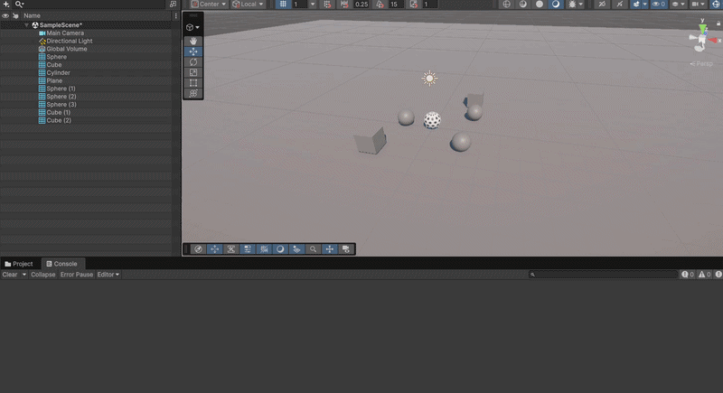

---

### Ejercicio 3
Diseño de zonas de activación mediante volúmenes con Is Trigger = true. Al cruzar la zona de cambio estético (OnTriggerEnter), se modifica el color del personaje, retornando a su apariencia original en OnTriggerExit. En una segunda zona delimitada para daño, la entrada del personaje incrementa de forma acumulativa una variable entera de daño mostrando el resultado por consola.

  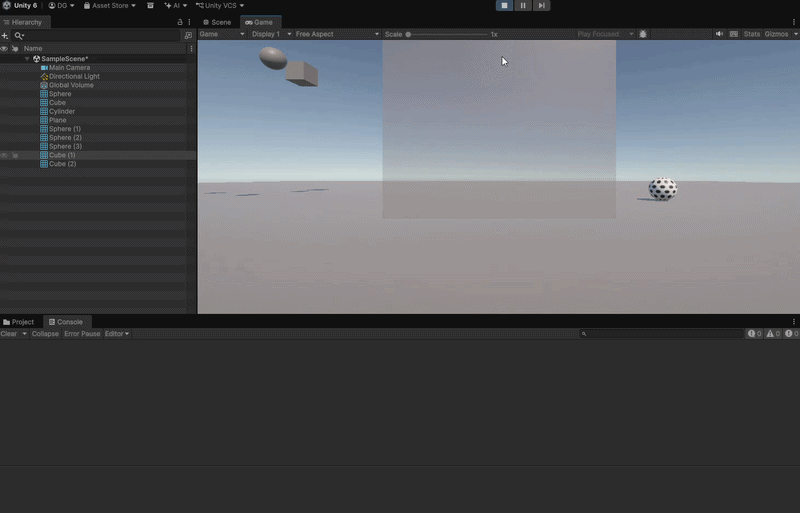

---

### Ejercicio 4
Segmentación de capas en Project Settings > Physics a través de la **Layer Collision Matrix** para tres roles diferenciados: Player, Enemy y Item. La matriz se configura para que los enemigos únicamente colisionen con el jugador (y el suelo), mientras que los recolectables interactúan exclusivamente con el jugador mediante detección por trigger, omitiendo cualquier respuesta física entre enemigos o ítems entre sí.

  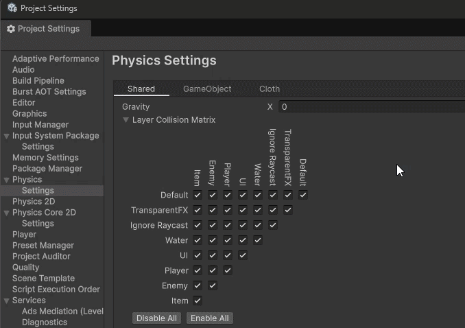

---

### Ejercicio 5
Experimentación con materiales físicos (Physics Material) con propiedades contrastadas: superficie resbaladiza de fricción nula, superficie rugosa de fricción máxima y superficie elástica de rebote extremo. Mediante la pulsación de la tecla X, se aplica un impulso horizontal y vertical simultáneo con Rigidbody.AddForce(..., ForceMode.Impulse), evidenciando las diferencias de amortiguamiento, derrape y rebote.

  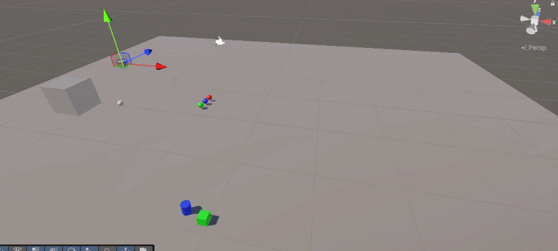

---

### Ejercicio 6
Disposición alineada de tres objetos estáticos (cubo obstáculo intermedio, esfera y cilindro objetivo) que poseen Collider pero **ninguno tiene Rigidbody**. Dado que Unity no dispara eventos de colisión ni triggers entre dos colliders puramente estáticos, la esfera se traslada hacia el cilindro mediante Vector3.MoveTowards en Update, comprobando de forma continua la intersección espacial entre los volúmenes de los colliders con esferaCollider.bounds.Intersects(cuboCollider.bounds) para cambiar el material del cubo en el instante del cruce.

  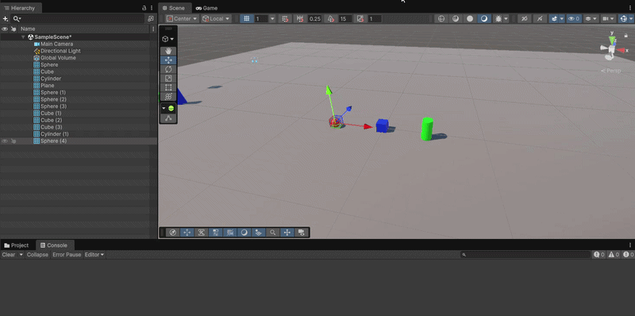

